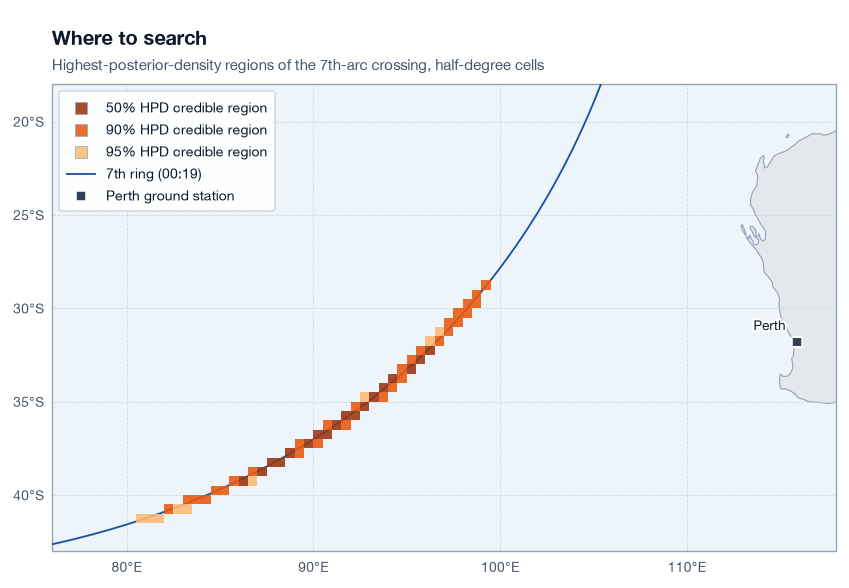

# Where Is MH370? Turning Seven Circles Into a Probability Map

> Seven satellite handshakes, a hand-written particle filter, and an honest answer to "where did flight MH370 end?".



**One notebook, three questions.** [`mh370_monte_carlo.ipynb`](mh370_monte_carlo.ipynb) rebuilds the Inmarsat burst-timing measurements of the night of 7–8 March 2014 and turns them into a probability map of where the aircraft crossed the final (7th) arc at 00:19 UTC:

| Question | Answer from the notebook |
|---|---|
| **Where?** | The most probable zone, the smallest region holding half of the probability, runs along the 7th arc from about 39.5°S to 32°S, south-west of Australia; posterior median 35.7°S (Monte Carlo sd 0.2°). No single half-degree square holds more than about 4% of it |
| **How sure?** | 90% credible interval 40.3°S to 30.1°S, about 1,750 km of arc. The Monte Carlo error of the posterior mean (0.16° with 10⁵ particles) is twenty times smaller than the posterior spread (3.2°) |
| **How fragile?** | Flight-dynamics assumptions move the answer by up to about 3°, the noise model by at most 0.4°, algorithm settings only by Monte Carlo noise. Computation buys down Monte Carlo error; it cannot buy down model uncertainty |

Every Monte Carlo brick is written by hand in NumPy and checked numerically right after its derivation (*proved, then observed*): the plain Monte Carlo estimator and its CLT, rejection sampling and its collapse, random-walk Metropolis and its autocorrelation time, importance sampling, the effective sample size, multinomial and systematic resampling, the SIR particle filter, and calibration on synthetic flights whose truth is known.

## Quick start

Requires [uv](https://docs.astral.sh/uv/). Python 3.12 and every dependency are pinned in `uv.lock`.

```bash
uv sync                                        # create .venv with the locked dependencies
uv run jupyter lab mh370_monte_carlo.ipynb     # read and run interactively
```

Re-execute the whole notebook headless (2 to 3 minutes on a recent laptop):

```bash
uv run jupyter nbconvert --to notebook --execute --inplace mh370_monte_carlo.ipynb
```

Plotly figures embed a static PNG copy, rendered by Kaleido with a local Chrome or Chromium; if none is installed, run `uv run plotly_get_chrome` once. On GitHub the notebook shows these static copies; open it in JupyterLab or VS Code for hover and the ping-by-ping animation.

## Reading map

The story advances ping by ping; each obstacle introduces the method that removes it. The three parts match the three speakers of the talk.

| Part | Chapter | The obstacle | The tool it forces on us |
|---|---|---|---|
| | Prologue, Chapter 0 | The case, the data and the assumptions | Sourced constants, the assumptions table, the visual system, the method on one figure |
| **I. From circles to samples** | Ping 1 — A ping is a circle | A delay is not a position | Measurement model, likelihood, Bayes' rule, the Monte Carlo estimator and its CLT |
| | Ping 2 — Simulate flights | We need a prior over whole flight paths | A stochastic motion model; rejection sampling and its collapse; random-walk Metropolis |
| **II. Making Monte Carlo work** | Ping 3 — Weigh, don't discard | Rejection throws away almost everything | Importance sampling, the self-normalised estimator |
| | Ping 4 — The weights collapse | A handful of flights carry all the weight | Weight degeneracy, effective sample size |
| | Ping 5 — Resample | The effort must be redistributed | Resampling, the SIR particle filter |
| | Interlude — Trust, but verify | Can we believe the filter? | Calibration on synthetic flights with a known truth |
| **III. The answer and its fragility** | Ping 6 — The cloud moves south | Run it on the real data | Sequential filtering, ping by ping |
| | Ping 7 — The final arc | Where should ships search? | Probability map, credible regions, Monte Carlo error versus uncertainty |
| | Epilogue A — How fragile? | What if our assumptions are wrong? | Sensitivity analysis, model evidence |
| | Epilogue B — Reality check | What did the real search find? | Comparison with the searches, limits of the model |

**Reading aids.** Every investigation chapter (Ping 1 through Epilogue B, plus section 2.3) opens with an *In plain words* box (three sentences, no symbols), and every experiment is followed by a *What we actually ran* card printed by the code: what was simulated, how many runs, the settings and random streams, the run time and the result. Section 0.3 lists every modelling assumption with the section that tests it and its measured effect on the answer; section 0.6 draws the whole method on one figure, followed by the notation. The plotting helpers of Chapter 0 (section 0.4) contain no mathematics and can be skipped.

## Repository layout

```
mh370_monte_carlo.ipynb   the deliverable: all code, derivations, figures and results
pyproject.toml, uv.lock   environment (uv, Python 3.12)
assets/                   figure used by this README (exported from the notebook)
```

## Data and assumptions

All real-world numbers (handshake times and BTO values, satellite positions, the calibration at Kuala Lumpur, the last radar fix, search areas, debris finds) come from the public investigation reports, Inmarsat's published analysis and the signalling-unit logs, cited in the notebook's References; the few values that could not be verified against a primary source are flagged as such where they are used. Two assumptions frame every result: the southern route is imported from the published Doppler (BFO) analysis, which is not modelled here, and the flight dynamics are deliberately simple. The assumptions table of section 0.3 lists these and every other modelling choice, with its measured effect on the answer.
